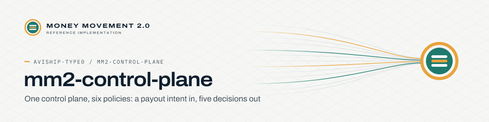

<p align="center">
  <picture>
    <source media="(prefers-color-scheme: dark)" srcset=".github/brand/banner-mm2-control-plane-dark.svg">
    <source media="(prefers-color-scheme: light)" srcset=".github/brand/banner-mm2-control-plane-light.svg">
    
  </picture>
</p>

# Money Movement 2.0 — payout control plane (reference implementation)

One control plane, six policies. A payout intent goes in; five decisions come out — **source, entity, evidence, timing, rail** — priced line by line against the decision that spent each line, posted to a double-entry ledger, and recorded as an immutable **trace** that names the **perimeter** the payout ran inside and registers every **follow-on** event (reserve release, rail confirmation, netting close, re-check) against its own id. Built to sit beside Nium's documented Transfer Money / Wallets / Onboarding v5 / RFI v5 / Verify / USDC-funding surface. Dependency-free JavaScript: the same engine runs the tests, the CLI, an HTTP API and the browser demo.

| | |
| --- | --- |
| **Owner** | Avi Reddy |
| **Status** | Reference implementation; not a live service |
| **Try it** | `npm test`, then `npm run demo` |

```
npm test                       # 17 tests, incl. every knob combination of the six scenarios (all approved ledgers balance)
npm run demo                   # print the six traces
node src/cli/demo.js gaming lic=1        # a knob: MGA-only operator → DECLINED (MARKET_REGISTRATION_REQUIRED)
node src/cli/demo.js agent net=2         # per-call payouts → HELD (UNECONOMIC_ROUTE)
node src/cli/demo.js marketplace payee=1 # USDC to a Brazilian seller → DECLINED (Res. 561, via appetite exclude)
npm run serve                  # HTTP on :8402 — POST /api/mm2/v1/client/{id}/payouts
npm run bundle                 # dist/mm2-engine.js → window.MM2 for the browser
```

Docs: `docs/HLD.md` (design doctrine, context, components, money-flow models, NFRs, deployment) · `docs/LLD.md` (data model, state machine, policy DSL, appetite table, reason codes, sequences, API mapping) · `api/openapi.yaml`.

Everything here is built from Nium's public documentation and job postings; amounts, rates and partner names are illustrative. Author: Avi Reddy, September 2026.
