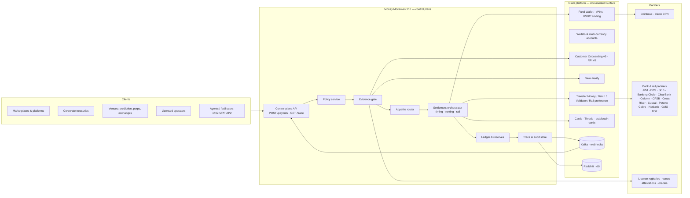
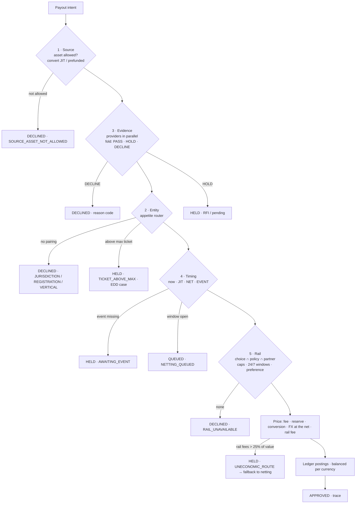

# Money Movement 2.0 — High-Level Design

**Scope.** A payout control plane that sits beside Nium's existing payout pipeline and turns six new flow types — stablecoin settlement, marketplace split payouts, high-risk verticals, agent settlement, prediction-market resolution payouts, perpetuals collateral/PnL — into *policies on one rail* instead of six products. Built from Nium's public documentation and job postings only; every integration point below is a documented Nium API or a named public partner.

## 1. Design goals and non-goals

| Goal | How the design meets it |
|---|---|
| Every payout leaves an audit object | The **trace** is the unit of record: policy version, five decisions, evidence results, router trail (including partners skipped and why), route, cost, ledger postings, outcome + reason code. |
| New flows without new products | A **policy** (data, versioned) declares source, entity, evidence, timing, rail and pricing. Adding a vertical = adding a policy and an appetite row, reviewed by Risk. |
| No contagion to the core network | The **appetite router** only ever pairs a payout with a Nium entity + partner that has declared appetite for that vertical, jurisdiction, ticket, licence set and rail. Partners without appetite never see the flow. |
| Live inside Nium's constraints | Event-driven beside Transfer Money; **netting** before a wallet's 3 TPS; evidence fetched in parallel with TTL caches; idempotent on `x-request-id`. |
| Regulation as an input, not a memo | Jurisdiction exclusions (e.g. Brazil Res. 561 for stablecoin settlement), coin whitelists (GENIUS DASP dates), licence requirements (iGO, UKGC, MGA, CFTC DCM) are router/evidence data with effective dates. |

Non-goals: acquiring; issuing a stablecoin; replacing Transfer Money, Wallets, Onboarding or RFI; custody of digital assets (Nium's stated model is "Nium does not hold USDC").

### 1a. Design doctrine — six rules the plane is built by

| Rule | What it means here | Where it lives |
|---|---|---|
| **1. Own the decisions; rent nothing you already own.** | Nium already owns the rails and the licences. What it rents today is the *decision* — the client decides, Nium executes. The plane moves the decision inside: the client declares, Nium decides. The rail is the last decision, not the product. | `ControlPlane.evaluate` — five decisions, one call |
| **2. Perimeter before product.** | Nothing new ships as a product; it ships as a **perimeter** — entity × jurisdiction × vertical × currency × ticket band × evidence set × rails × timing — that a partner has opted into. A payout runs inside a perimeter or it doesn't run. A new vertical is a new perimeter, not a new product; a prohibition becomes a perimeter with a price. | `perimeter.js`, `partners/appetite.json`, `trace.perimeter` |
| **3. Cost at the granularity the rail emits.** | No blended basis points. Every fee, spread, reserve and rail charge is a line, in the currency it is charged in, **attributed to the decision that spent it** (source, entity, timing, rail, policy). Appetite is priced from lines, not guessed. | `priceRoute` lines `[label, amount, decision]` |
| **4. Every later event cites the decision that created it.** | A reserve release, a rail confirmation, a return or recall, a netting close, an event trigger, a re-check, a manual review — each is registered on the trace as a **follow-on** carrying the trace id. Attribution is the audit; the audit is what Risk and the bank partner buy. | `trace.followOns`, `followOn()` |
| **5. The identifier carries the decision.** | Evidence attaches to the seller, the agent, the venue, the operator — not to the payout. Verify once, decide many; re-check on triggers, not on every call. The registries (sellers, agents, venues, operators) are the asset; payouts are the throughput. | evidence providers keyed by beneficiary / principal / venue; KYA registry |
| **6. What incumbents refuse at the cusp, the market funds next.** | Every line on a prohibited list is a segment someone else is being paid to serve. The router exists so "no" can become "yes — on this partner, with this evidence, at this price", one perimeter at a time, without touching the core network. | `router.js` reason codes; appetite rows with effective dates |

## 2. Context — where it sits

## 3. Components

| Component | Responsibility | Nium touchpoint (public) | Reference implementation |
|---|---|---|---|
| **Control-plane API** | Accept payout intents; idempotency; return traces | Same conventions as Nium API (`x-api-key`, `x-request-id`, unified validation errors) | `api/openapi.yaml`, `src/api/server.js` |
| **Policy service** | Versioned policy registry + evaluator for the five decisions | — (new) | `src/engine/policy.js`, `policies/*.json` |
| **Evidence gate** | Run evidence providers in parallel; fold to PASS / HOLD / DECLINE with reason codes; open RFIs on HOLD | Onboarding v5, RFI v5, Verify, sanctions screening, OFI screening; registries and attestations via adapters | `src/engine/evidence.js` |
| **Appetite router** | Pair the payout with a Nium entity + partner with declared appetite; emit the trail | VAN/bank-partner table is the physical form of the appetite table | `src/engine/router.js`, `partners/appetite.json` |
| **Settlement orchestrator** | Timing (now / JIT / netting / event), rail selection under caps and windows, pricing (fee, reserve, FX at the net, rail fee), uneconomic-route guard | Transfer Money, Batch Payout, Payout Rail Preference, FX quotes/locks, Fund Wallet (USDC), Card balance load | `src/engine/settlement.js` |
| **Ledger & reserves** | Double-entry postings per currency; FX positions; rolling reserves with release dates | Wallet ledger; settlement reports | `src/engine/ledger.js` |
| **Trace & audit store** | Immutable trace per payout; export to Risk/partners/regulators | Redshift/dbt (reporting); webhooks (`MM2_TRACE_*`) | `src/engine/trace.js` |
| **Agent registry (KYA)** | Agents mapped to KYB-verified principals; mandates; reputation | Customer Onboarding v5 for the principal | provider `agentPrincipal`, `mandate` |
| **Netting engine** | Accumulate streamed receipts; close on window or threshold; emit rail-sized payouts | Batch Payout API; wallet 3 TPS limit | `NettingWindow` |

## 4. The five decisions (per payout)

## 5. Money-flow models the plane runs

1. **Pre-funded fiat payout** — client wallet (safeguarded EMI money / US sponsor-bank custodial account) → Nium nostro at the destination partner → local rail.
2. **Just-in-time stablecoin funding** — USDC to a static address → Circle/Coinbase custody + conversion → USD wallet → payout. Nium never holds the asset.
3. **Marketplace three-tier split** — PSP sweep → Platform Receivables → Fees / Seller MCY / Base → seller payout by seller choice (bank, USDC, card).
4. **Event-triggered payout** — resolution / delivery / attestation arms the payout; evidence gate; immediate rail.
5. **Streamed-then-netted** — micro-receipts in escrow → one rail-sized payout per beneficiary per window (or threshold), FX at the net.
6. **Collateral on-ramp / PnL off-ramp** — local RTP collection → USDC → venue; USDC PnL → local fiat, with venue attestation.
7. **Risk-reserved payout** — fee + rolling reserve + partner-scoped appetite; sender pays on top; reserve released T+N.
8. **Scheme-level stablecoin settlement of Nium's own card book** (SoFi/Mastercard pattern, Visa USDC settlement pilot) — a policy on the settlement asset, not a product.

## 6. Non-functional requirements

| NFR | Target | Mechanism |
|---|---|---|
| Decision latency | p50 < 50 ms with cached evidence; p99 < 400 ms with two live lookups | evidence providers async + TTL cache; router is pure |
| Throughput | 1,000 intents/s sustained; bursts (resolutions, streams) absorbed by netting and queues | Kafka partitions by beneficiary; netting windows; Batch Payout (1,000) |
| Availability | 99.95% for decisioning; margin-time SLA windows (weekend/overnight) explicitly priced and monitored | multi-AZ on AWS; degrade to HOLD (never silent approve) when a provider is down |
| Auditability | 100% of payouts have a trace; traces immutable; retention 7 years | append-only store; hash-chained per client |
| Idempotency | exactly-once decision per `x-request-id` for ≥ 24 h | key-value cache keyed by client + request id |
| Security / privacy | PII minimisation in traces (evidence results, not documents); PCI scope unchanged (card widget stays Nium-hosted) | tokenised references into Onboarding/RFI |
| Regulatory change | effective-dated appetite and policy rows; dry-run mode (like Payout Validator) | policy versioning; `validate` endpoint |

## 7. Deployment on Nium's documented stack

Java/Spring Boot services on Kubernetes (AWS), MySQL for policy/appetite/trace metadata, Kafka for intents and trace events, Redis for evidence TTL cache and idempotency, S3 for trace archives, Redshift/dbt for reporting, Datadog/Prometheus for SLOs, Terraform, Jenkins/ArgoCD. The reference implementation here is dependency-free JavaScript so the same engine runs in tests, a CLI, an HTTP server and the browser demo; the production port is a one-to-one translation of `src/engine/*` into Spring services.

## 8. Rollout (matches the strategy's four quarters)

Q4 2026 — policy engine v1, trace on the existing payout path (shadow mode: decide, don't route), appetite router with three partners, stablecoin payout beta. Q1 2027 — marketplace seller-choice + lineage; two prediction-market pilots (US DCM B2B, LatAm). Q2 2027 — HRV GA with priced verticals and reserves; perps on/off-ramp; margin-time SLA. Q3 2027 — agent registry + facilitator + netting GA.
