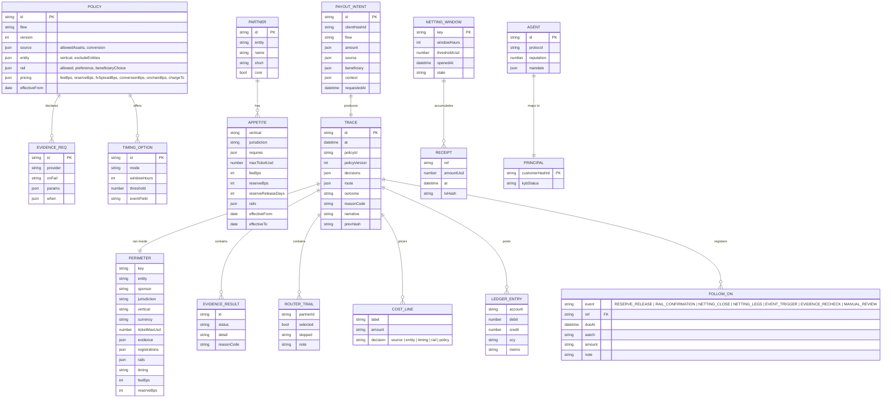
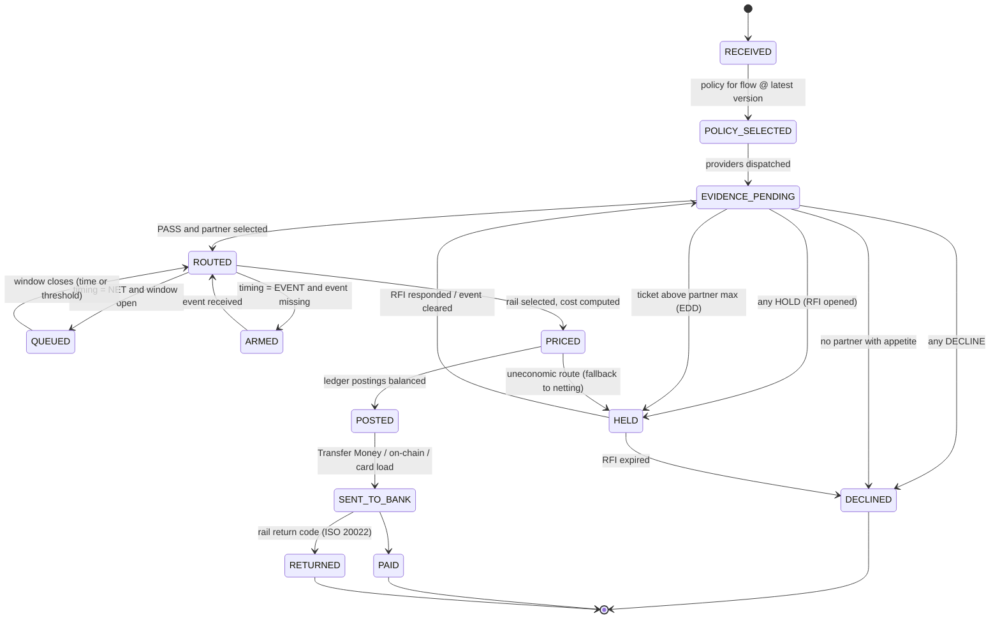

# Money Movement 2.0 — Low-Level Design

## 1. Data model



**Perimeter.** Derived, never hand-configured: `policy ∩ partner appetite ∩ beneficiary`. `key = entity|jurisdiction|vertical|currency|timing` — ticket size, payee name and amount do *not* change the key, so two payouts in the same box get the same decisions and a Risk sign-off is a sign-off on the box. A payout with no opted-in partner has a perimeter with `entity = null` and is declined by the router before any rail is touched.

**Cost lines.** Every priced line carries the decision that spent it: conversion → *source*; risk-priced fee and rolling reserve → *entity* (the appetite that priced them); rail fee → *rail*, or *timing* when the netting decision set the number of legs; FX spread and on-ramp conversion → *rail* (the rail's currency forced them); sender-pays uplift → *policy*. The two total lines (all-in bps, beneficiary receives) are unattributed.

**Follow-ons.** Any state the payout can enter later is registered at decision time with `ref = trace.id`, so the later event is written against the decision that created it rather than reconstructed from it: `RESERVE_RELEASE` (dueAt = T+N), `RAIL_CONFIRMATION` (confirmation, return or recall land here), `NETTING_CLOSE` / `NETTING_LEGS`, `EVENT_TRIGGER` (armed payouts), `EVIDENCE_RECHECK` (holds), `MANUAL_REVIEW` (ticket above max). A decline registers nothing — it has no future.

## 2. Payout state machine



The states from `SENT_TO_BANK` onward are Nium's existing Transfer Money lifecycle (`SENT_TO_BANK`, `PAID`, `RETURN`); the control plane owns everything before it and subscribes to the payout webhooks to close the trace.

## 3. Policy DSL

A policy is JSON. Field reference (see `policies/*.json` for the six shipped policies):

```jsonc
{
  "id": "pol-gaming-licensed",
  "flow": "gaming",
  "version": 1,

  // what the money may be when it arrives; conversion: JIT | PREFUNDED | NONE
  "source":   { "allowedAssets": ["CAD", "GBP", "EUR", "BRL", "USD"], "conversion": "NONE" },

  // the vertical the router prices; entities that must never carry it
  "entity":   { "vertical": "gaming", "excludeEntities": ["Nium Pte Ltd (MAS MPI)"] },

  // what must be true before it moves; onFail folds DECLINE > HOLD > WARN
  "evidence": [
    { "id": "operator", "provider": "operatorLicence", "requiresAll": ["MGA"],
      "onFail": "DECLINE", "reasonCode": "LICENCE_REQUIRED" },
    { "id": "kyc",      "provider": "kyc", "onFail": "HOLD" },
    { "id": "attest",   "provider": "attestation", "onFail": "HOLD",
      "when": { "field": "context.direction", "equals": "withdrawal" } }
  ],

  // NOW | JIT | NET | EVENT — or "options": [{ id, mode }] the intent picks from
  "timing":   { "mode": "NOW" },

  // rails the policy admits; preference REALTIME | CHEAPEST; beneficiaryChoice: local | usdc | card
  "rail":     { "allowed": ["interac", "eft_ca", "fps_uk", "sepa_inst", "pix"],
                "preference": "REALTIME", "beneficiaryChoice": false },

  // priced per line and attributed; reserveBps may come from the partner instead
  "pricing":  { "feeBps": 85, "fxSpreadBps": 0, "reserveReleaseDays": 30, "chargeTo": "SENDER" }
}
```

Evaluation rules: evidence `onFail` folds as DECLINE > HOLD > WARN; `when` makes a requirement conditional; `timing.options` lets the intent pick (`context.timingOption`) among policy-approved modes; `rail.beneficiaryChoice` admits `local | usdc | card`; `pricing.chargeTo` is `BENEFICIARY` (deducted) or `SENDER` (on top); reserve = `pricing.reserveBps ?? partner.reserveBps`.

## 4. Appetite table (router input)

| Field | Meaning |
|---|---|
| `entity` | The Nium licensed entity that carries the flow (Nium Inc, UAB Nium EU, Nium Fintech Ltd, Nium Pte, Nium Canada, Nium IP Ltda…) |
| `verticals` | Declared appetite (`marketplace`, `payroll`, `treasury`, `creator`, `gaming`, `prediction_markets`, `perps`, `crypto`, `agent_settlement`, or `*`) |
| `jurisdictions` / `exclude` | Country or sub-national codes (`CA-ON`, `US-NJ`); `exclude` overrides `*` (e.g. `BR` for stablecoin pairings under Res. 561) |
| `requires` | Licences the *operator/venue* must hold per jurisdiction, optionally per vertical: `{ "CA-ON": ["iGO"], "GB": ["UKGC"], "BR": { "gaming": ["SPA_BR"] } }` |
| `rails` | Rails the pairing can settle on (`*` for any) |
| `maxTicketUsd`, `feeBps`, `reserveBps`, `reserveReleaseDays` | Commercial terms of the pairing |
| `core` | The core network partner — always shown explicitly in the trail even when skipped |

Router algorithm (`src/engine/router.js`): iterate partners in preference order; skip with a reason code on entity exclusion, vertical, jurisdiction/exclude, missing required licences, rail mismatch; mark `aboveMax` on ticket cap; first eligible wins. Output: `{ selected, aboveMax, trail }`.

## 5. Reason codes

| Code | Outcome | Meaning |
|---|---|---|
| `SOURCE_ASSET_NOT_ALLOWED` | DECLINED | Asset not in policy `source.allowedAssets` |
| `KYB_PENDING` / `KYC_PENDING` / `SOF_PENDING` / `ATTESTATION_PENDING` / `AWAITING_RESOLUTION` / `VELOCITY_EDD` | HELD | Evidence pending; RFI opened |
| `KYB_REJECTED` / `SANCTIONS_HIT` / `PURPOSE_MISSING` / `LINEAGE_MISSING` / `RG_FLAG` / `LICENCE_REQUIRED` / `VENUE_LICENCE_REQUIRED` / `VENUE_OUT_OF_APPETITE` / `AGENT_PRINCIPAL_UNVERIFIED` / `MANDATE_MISSING` / `MANDATE_EXCEEDED` | DECLINED | Evidence failed with `onFail: DECLINE` |
| `NO_APPETITE_VERTICAL` / `JURISDICTION_OUT_OF_APPETITE` / `MARKET_REGISTRATION_REQUIRED` / `ENTITY_EXCLUDED` / `RAIL_UNAVAILABLE` | DECLINED | Router found no pairing |
| `TICKET_ABOVE_MAX` | HELD | Pairing exists; ticket above its cap; EDD case |
| `AWAITING_EVENT` | HELD | Event-timed payout armed |
| `NETTING_QUEUED` | QUEUED | In an open netting window |
| `UNECONOMIC_ROUTE` | HELD | Rail fees > 25% of value; fallback to netting |

## 6. Sequences

### 6.1 Marketplace split → Pix
```mermaid
sequenceDiagram
  participant PSP as Stripe/Adyen
  participant WL as Nium Wallets (Receivables/Fees/Seller)
  participant CP as Control plane
  participant EV as Evidence (Onboarding v5 · Verify · sanctions)
  participant TM as Transfer Money
  participant BR as Nium Brasil · BS2 · Pix
  PSP->>WL: sweep to virtual account (ICC webhook)
  WL->>CP: intent(flow=marketplace, split 12%, seller BR, choice=Pix)
  CP->>EV: KYB · lineage · sanctions · Verify (parallel)
  EV-->>CP: pass ×4
  CP->>CP: router: Partner A skipped (US only) → Nium Brasil + BS2 selected
  CP->>CP: timing EVENT(order settled) · rail Pix · price FX 45 bps at the net
  CP->>WL: post Receivables → Fees / Seller MCY; Seller MCY → payout clearing
  CP->>TM: create payout (LOCAL, Pix key, purpose code, externalID=trace id)
  TM->>BR: Pix
  BR-->>TM: PAID webhook
  TM-->>CP: close trace (PAID)
```

### 6.2 x402 agent settlement → UPI (netted)
```mermaid
sequenceDiagram
  participant AG as Agent (x402 client)
  participant FC as Facilitator (Nium) + escrow (Coinbase custody)
  participant NW as Netting window
  participant CP as Control plane
  participant KYA as Agent registry
  participant TM as Transfer Money
  loop 4,120 calls over 24h
    AG->>FC: HTTP 402 → signed USDC authorisation (EIP-3009)
    FC->>NW: receipt(agent, beneficiary, USD 0.02)
  end
  NW->>CP: window close → intent(USD 82.40, IN, INR)
  CP->>KYA: principal verified? mandate cap?
  KYA-->>CP: verified · USD 82.40 ≤ USD 500/day
  CP->>CP: router → Nium SG → Nium India / AD-I bank; rail UPI; FX 35 bps at the net
  CP->>TM: one payout (INR), purpose: business services, e-FIRA
```

### 6.3 Licensed gaming → Interac (router with reserve)
```mermaid
sequenceDiagram
  participant OP as Operator (MGA + iGO)
  participant CP as Control plane
  participant RT as Appetite router
  participant LG as Ledger
  participant TM as Transfer Money
  OP->>CP: payout file → intent(CAD 2,150, CA-ON)
  CP->>RT: evaluate pairings
  RT-->>CP: A skipped (no gaming) · B skipped (GB/MT only) · C selected (CA-ON, requires iGO ✓, max CAD 25k)
  CP->>LG: debit operator CAD 2,276.25 (2,150 + 85 bps + 5% reserve + rail); credit reserve (T+30), fee revenue, payout clearing
  CP->>TM: Interac e-Transfer (autodeposit)
```

## 7. API mapping to Nium's documented surface

| Control-plane step | Nium API / product (public docs) |
|---|---|
| Intent ingestion | Kafka topic from payout requests; or `POST /client/{clientHashId}/payouts` (this API) |
| Dry-run | Nium Payout Validator (`POST …/remittance/validate`) + policy dry-run |
| Evidence: KYC/KYB | Customer Onboarding v5, ODD webhooks, RFI Flow v5 |
| Evidence: account | Nium Verify (`POST /api/v1/client/{clientHashId}/verifications`) |
| Evidence: originating parties | OFI screening (`originating_parties`) |
| Funding: USDC | Assign Payment ID with `bankName = CIRCLE_CA` + `network`; Coinbase custody/conversion |
| Payout | Transfer Money (`…/remittance`), Batch Payout API (1,000), `preferences.payoutRail`, purpose codes, `externalID` |
| Card load | Card balance / dynamic authorisation (Thredd) |
| Tracking | `REMIT_TRANSACTION_SENT_TO_BANK_WEBHOOK` (`estimatedDeliveryTime`, gpi), `PAID`, `RETURN` (ISO 20022 codes) |
| Reporting | Settlement reports; async account statements; Redshift/dbt |

## 8. Repository layout

```
mm2-control-plane/
  api/openapi.yaml            control-plane API
  policies/*.json             six policies (marketplace, stablecoin, prediction, perps, agent, gaming)
  partners/appetite.json      appetite table (12 entity+partner pairings)
  scenarios/*.json            six runnable scenarios with knobs and narratives
  src/engine/                 money · policy · evidence · router · ledger · settlement · trace · perimeter · controlplane · scenario · load
  src/cli/demo.js             node src/cli/demo.js [scenario] [knob=option ...]
  src/api/server.js           node src/api/server.js  (HTTP on :8402)
  scripts/bundle.js           builds dist/mm2-engine.js for the browser (window.MM2)
  test/engine.test.js         14 tests incl. every knob combination (node --test)
  docs/HLD.md · docs/LLD.md
```
